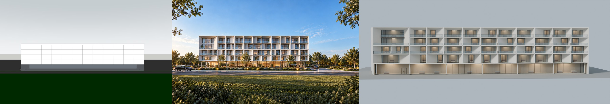
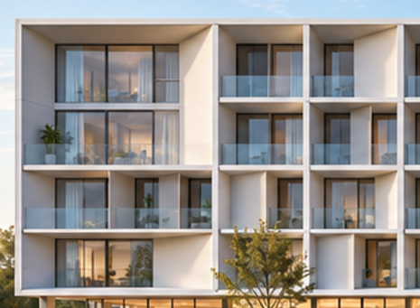
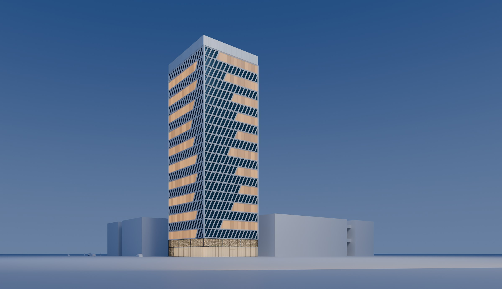
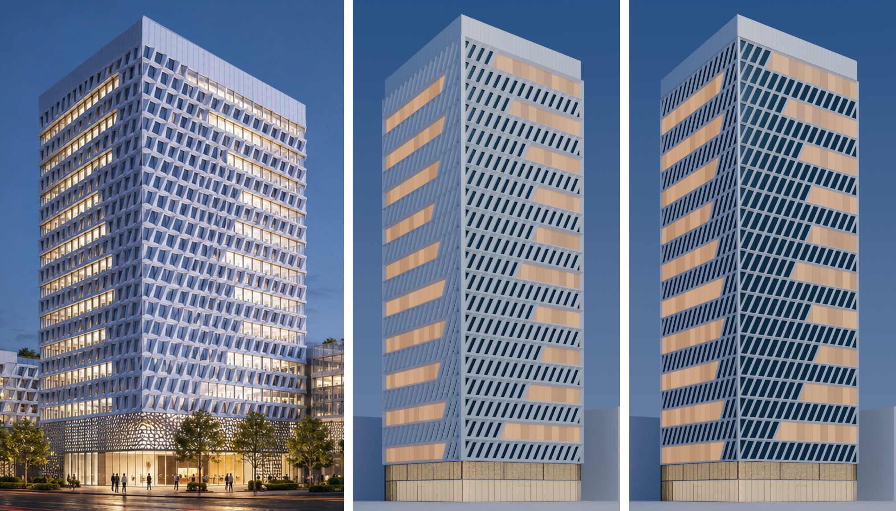

# massing-facade-rebuild · 基于体块的立面重建

> 体块定几何，效果图定语言。

一个给 AI agent 用的 skill：在你已有的 SketchUp 体块上，把一张经你确认的效果图，转译成 Blender 里可编辑、可核验的立面模型。



[English](README.en.md)

## 为什么做这个

网上很多"AI 一句话建模"的演示，是对着一张照片凭空去建。真实项目不是这样：先有体块，再在体块上深化立面。层数、标高、尺寸由体块说了算，效果图只负责立面语言。

这个 skill 把这条真实的设计流程交给 agent 来跑：体块不动，立面照着效果图长出来；看不清的地方如实标成推定，关键决定停下来问设计者。

## 它怎么工作

| 阶段 | 做什么 | 关卡 |
|---|---|---|
| 0 检查输入 | 清点文件，开始运行记录 | 缺底模或效果图就停 |
| 1 锁定底模 | 读出单位、层数、标高、立面朝向，生成几何事实卡 | 和 SU 截图对不上就问 |
| 2 出图（可选） | 用内置提示词模板出效果图 | 设计者确认这就是方向 |
| 3 比例关卡 | 判定立面类型（不规则 / 母题重复），核对比例 | 设计者确认类型和推定 |
| 4 判读 | 逐单元或按母题记录，可见、推定、修正分开标注 | 每个单元都有据可查 |
| 4.5 样件 | 先建一小片，和效果图并排对照 | 设计者逐项确认后才铺满 |
| 5 建模 | 在体块副本上建立面，原始网格不动；铺满前先列出所有收头 | — |
| 6 检查与核验 | 固定视角出检查图，另出一张和效果图同视角的对照渲染；核验体块没被改动 | 核验通过，设计者看过 |
| 7 交付归档 | 交付模型、记录和核验报告，只复制归档 | — |

每个阶段都留下文件，换一个会话也能接着做。

## 两个案例

### 公寓：不规则洞口立面



- 输入：SU 导出的 FBX、SU 截图、一张目标效果图、一张局部裁图
- 成功的那一轮约 1 小时、约 315 万 token，基本用完一个 5 小时额度窗口（GPT-6 Astra，最高推理强度）
- 逐洞口记录 45 条；核验确认原始体块网格未变，新增构件不越界，未使用阵列修改器
- 被树挡住的两个洞口、图上看不出的进深，都标成了推定

### 办公塔楼：母题重复立面



- 30×30 米塔楼：8 米通高商业、20 层办公、4 米顶冠；只建效果图里看得到的两个面和它们的转角
- 效果图里一个单元只有十几个像素。看不清的部分，设计者先后补了一个单元模型、一小片排布、整面排布和关键尺寸（节距、逐层错位），以及一条转角规则
- 样件改了四轮，依次修正了形体、构造和构件关系；第一次铺满后，因为逐层错位没定，转角收头逐层不同，定了尺寸再重建
- 全程 GPT-6 Astra、最高推理强度：从开考到交付约 8,300 万 token（已记录部分），主会话累计约 7 小时，前后近三周，中断续跑 20 次

最后一轮，AI 已经能照效果图做到很像（中，白框约占立面的 72%）；设计者为办公采光，选了更细的框（右）。这个偏离记在 `adaptation.md` 里，是有意的取舍。



*左：确认的效果图　中：照效果图做到的 B 档　右：设计者选定的正式模型*

## 两个案例说明了什么

- **效果图讲得清的，AI 一遍就能做对；讲不清的，要设计者来补规则。** 成本也跟着变：塔楼的 token 约是公寓成功那一轮的 26 倍。
- **AI 能做到像，设计师决定要不要像。** 照图还原只是起点；采光、使用这些生图模型不管的事，由设计者拍板。

成本明细和统计口径见 [实验记录](references/benchmark-attempts.md#成本对比)。

## 人和 AI 各管什么

- **体块不可改。** 和效果图冲突时，以体块为准。
- **效果图是设计意图，不是施工图。** 构造按常规理解：玻璃和窗是标准矩形，异形造型是外挂的"衣服"。照图还原会影响采光、通风时，AI 指出来，由你取舍。
- **局部推定可以，整体发明不行。** 进深、被遮挡的部分可以推定；整面怎么构成、怎么变化，必须来自效果图或设计者。
- **设计意图归你，实现细节归 AI。** 构造逻辑、整体读感、关键尺度由你定；孔洞位置、尺寸微调由 AI 定；你还没想好的地方，AI 出两种方案给你挑。
- **看见的、推定的、修正的，分开写。** 每个判断都有出处；有意偏离效果图的地方，记为取舍。

完整规则见 [SKILL.md](SKILL.md)。

## 快速开始

**需要：**

- Blender，能在命令行运行（`blender --background --python 脚本.py`）
- 一个能读写本地文件、运行命令的 agent。本 skill 在 Codex + GPT-6 Astra 上测试过，建议用最高推理强度
- 输入：
  - SU 导出的 FBX 体块，目标建筑单独成组，用英文命名
  - 和效果图同视角的 SU 截图，只画楼层线、开间线这类控制线
  - 一张你确认过的效果图，或 1–2 张风格参考图（交给阶段 2 出图）
  - 最复杂部位的局部裁图
  - 可选：一个母题单元模型，效果图里单元看不清时用

**安装：** 把整个文件夹放进 agent 的 skills 目录（如 Codex 的 `.agents/skills/`、Claude Code 的 `.claude/skills/`，以各工具文档为准），或者直接在对话里让 agent 读 `SKILL.md` 的路径。

**开场白：**

```
请使用 massing-facade-rebuild skill：先完整阅读 SKILL.md 及其 references/，按其中的阶段和关卡执行。

任务：在体块上重建 ____ 的立面。
- 输入：____（只读）
- 目标建筑：____（SU 里的分组名）；其余为保护范围
- 范围：____（例如只建效果图里看得到的面）
- 项目信息：____（建筑类型、各层功能、层高）
- 产出写在：____

做到阶段 4.5 样件出图后停下，等我确认。
```

## 已知限制

- 细粒度的渐变肌理，生图模型画不清，目前不适合这个流程
- 母题在效果图里看不清时，需要设计者补单元模型和关键尺寸，返修和成本都会明显上升
- 核验只查构件的宽高边界，不查进深
- SU 导出 FBX 有几个坑：分组名会被自动加编号，中文名会变成下划线，单位可能标错（阶段 1 会核对）
- 只在 Codex + GPT-6 Astra 上完整测试过；四面全包、曲面体块还没测过

## 目录

```
massing-facade-rebuild/
├── SKILL.md                   # 流程、关卡和原则
├── README.md                  # 中文说明
├── README.en.md               # English
├── LICENSE
├── scripts/                   # 导入、事实卡、检查图、核验
├── references/
│   ├── render-prompt.md       # 出图提示词模板
│   ├── opening-record.csv     # 逐单元记录模板
│   ├── motif-record.md        # 母题记录模板
│   ├── geometry-vocabulary.md # 几何术语表
│   ├── run-record.md          # 运行记录字段
│   └── benchmark-attempts.md  # 实验史与成本对比，包括失败的每一轮
└── docs/images/               # README 配图
```

## 实验记录

[benchmark-attempts.md](references/benchmark-attempts.md) 记下了两个案例从失败到成功的每一轮，也写清了哪些结论有证据、哪些没有。比如"Ultra 是成功的唯一原因"，就属于证据不支持的那一类；"塔楼贵只是因为立面类型"也是。

## 许可

MIT，见 [LICENSE](LICENSE)。

## 作者

H.C. Lai · [hclai.studio](https://hclai.studio)

## 致谢

这个 skill 的规则和文档，是作者和 Claude（Anthropic）在一轮轮对话里一起磨出来的；建模和脚本由 Codex（GPT-6 Astra）在测试中写成。
